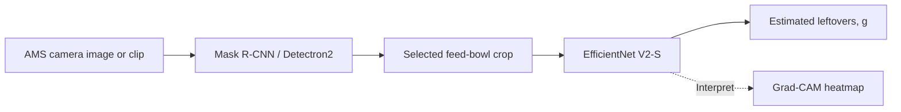

# Estimation of Concentrate Leftovers in Automated Milking Systems Using Computer Vision

**Study overview, detailed Materials and Methods, and a downloadable Windows GUI for estimating the weight of concentrate remaining in an automated milking system (AMS) feed bowl.**

This repository accompanies *Estimation of automated milking system concentrate leftovers with 2-dimensional images and machine learning* (Thomas et al.; manuscript in preparation). It provides methodological details that complement the more concise Materials and Methods section of the manuscript, along with instructions for using the trained models through a Windows application.

## Research purpose

AMS software typically records the amount of concentrate **dispensed** during milking. However, some of that feed may remain in the bowl, so the amount dispensed does not necessarily equal the amount **consumed**. Accurate estimation of leftovers could improve individual-cow concentrate-intake estimates without requiring manual weighing after every visit.

**The objective of this study was to develop and evaluate a camera-based method for estimating the mass of concentrate leftovers (g) using two-dimensional images of AMS feed bowls.**

The approach comprises three components:

1. **Feed-bowl detection:** A one-class Mask R-CNN detector, implemented with Detectron2, identifies the bowl in camera images or sampled video frames.
2. **Leftover-weight estimation:** The detected rectangular bowl crop is passed to an EfficientNet V2-S regression model to estimate leftover mass in grams.
3. **Model interpretation:** Gradient-weighted Class Activation Mapping (Grad-CAM) highlights image regions associated with the regression output.



For an image already cropped to the feed bowl, the detection stage can be skipped. For clip input, the application chooses the highest-confidence accepted bowl crop and makes **one** weight prediction from that crop.

## Materials and Methods

The following pages expand on the scientific methods without requiring a lengthy methodological description in the journal article:

| Detailed method | Contents |
| --- | --- |
| **[01 — Object detection](Materials_and_Methods/01_object_detection.md)** | Camera input, clip processing, Mask R-CNN configuration, confidence-based selection, and bounding-box extraction |
| **[02 — Leftover-weight estimation](Materials_and_Methods/02_leftover_weight_estimation.md)** | Reference images and dataset partitioning, EfficientNet V2-S, preprocessing, training, back-transformation, and performance evaluation |
| **[03 — Grad-CAM interpretation](Materials_and_Methods/03_gradcam_interpretation.md)** | Grad-CAM for regression, heatmap generation, and limits of interpretation |

The model-development set comprised **315 known-weight images** spanning **0–1,000 g** (252 training and 63 internal-validation images). Separately, **92 naturally occurring observations** were initially available; after excluding two observations, **90** were retained for the final independent evaluation. These counts describe the documented analysis sets, not the contents of the example-data folder in the application release.

## Download the Windows GUI

**[Download the latest AMS Leftover Estimator for Windows](../../releases/latest)**

On the **Releases** page, download **`AMS-Leftover-Estimator-app.zip`** under **Assets**. Do not select GitHub's automatically generated *Source code (zip)* archive; it does not contain the runnable application.

The application ZIP contains the executable, its runtime dependencies, two trained model checkpoints, and a **selection of example files**:

```text
AMS-Leftover-Estimator-app/
├── AMS-Leftover-Estimator.exe
├── _internal/              Required runtime files
├── Model/
│   ├── Detectron2.pth      Trained bowl detector
│   └── EfficientNet.pth    Trained weight-regression model
└── data/                   Selected examples, not the full study dataset
    ├── Clips/
    └── Cropped images/
```

### How to use the GUI

1. **Download and extract** the full ZIP archive. Keep the EXE, `_internal/`, and `Model/` in their original relative locations.
2. Double-click **`AMS-Leftover-Estimator.exe`**. You do not need to install Python.
3. Check the compact **Model input** indicator. The application automatically finds the included checkpoints; click the indicator if you want to inspect the selected model paths or advanced settings.
4. Choose an input mode:
   - **Crop or Clip** (default): open an already-cropped feed-bowl image or a video clip.
   - **Full image**: open an uncropped still image so the app can first locate the bowl.
5. Select an image or clip. **Detection/prediction starts automatically**; the file picker initially opens in the EXE's folder.
6. Read the estimated leftover weight in **grams** and inspect the prediction preview. Use **Detect / Predict** to repeat the analysis after changing settings.

For a cropped image, the feed-bowl preview is shown as one large image. For a full image or video clip, the interface displays the source image/best frame, detection overlay, and selected crop. The **video-sampling default is 1.00 s** and can be changed in the GUI.

**Important:** The app is for inference using pretrained checkpoints; it does not train either network. A detector confidence score is not a confidence interval for the predicted leftover mass. Results should be interpreted within the range and conditions for which the models were evaluated.

### Troubleshooting

| Issue | Suggested check |
| --- | --- |
| Model not found | Keep `Model/Detectron2.pth` and `Model/EfficientNet.pth` in the extracted app folder; inspect **Model input** |
| EXE fails to open after moving files | Keep `_internal/` together with the executable |
| No bowl detected in a full image/clip | Check the image, selected detector checkpoint, and detection threshold |
| First prediction is slow | The deep-learning libraries and checkpoints may need to load on the first inference |
| Video cannot be opened | Try a compatible MP4 file; decoding depends on the included OpenCV codecs |

## Repository and data availability

This repository publishes **written Materials and Methods and GUI instructions only**. It does **not** contain Python source code, Jupyter notebooks, or model-training scripts. The compiled Windows GUI and trained `.pth` checkpoints are distributed as a GitHub Release rather than committed as regular repository files.

The release's `data/` folder contains **selected examples only**. The complete study dataset, original camera recordings, and associated research records are not distributed here. The method descriptions support understanding and use of the trained models but do not constitute a complete executable reproduction of training.

## Citation

**Associated manuscript (in preparation):** Thomas et al. *Estimation of automated milking system concentrate leftovers with 2-dimensional images and machine learning.* Please use the final published citation when available. When describing GUI-generated results, identify the application release and relevant settings.
