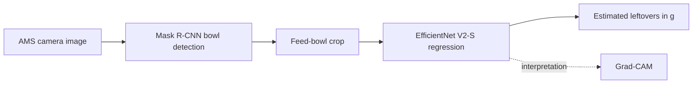

# Estimation of Concentrate Leftovers in Automated Milking Systems Using Computer Vision

**Research overview, detailed Materials and Methods, and a downloadable Windows application for estimating concentrate leftovers from automated milking system (AMS) camera images.**

This repository accompanies *Estimation of automated milking system concentrate leftovers with 2-dimensional images and machine learning* (Thomas et al.; manuscript in preparation).

## Overview of the approach

The study combined three complementary methods:

1. **Object detection:** A one-class Mask R-CNN model implemented in Detectron2 identified the feed bowl in images or video frames and supplied a rectangular bowl crop.
2. **Leftover-weight estimation:** An EfficientNet V2-S regression model estimated the mass of concentrate remaining in each selected bowl crop.
3. **Model interpretation:** Gradient-weighted Class Activation Mapping (Grad-CAM) was used to visualize image regions associated with the regression output.

## Materials and Methods

These pages provide methodological details that would be too extensive for the main JDS Communications manuscript.

| Section | Description |
| --- | --- |
| [01 — Object detection](Materials_and_Methods/01_object_detection.md) | Camera input, Mask R-CNN, detection criteria, and extraction of the feed-bowl crop |
| [02 — Leftover-weight estimation](Materials_and_Methods/02_leftover_weight_estimation.md) | Reference data, EfficientNet V2-S training, image preprocessing, prediction, and model evaluation |
| [03 — Grad-CAM interpretation](Materials_and_Methods/03_gradcam_interpretation.md) | Regression Grad-CAM workflow and interpretation of activation maps |

## Windows GUI application

A Windows application is available for applying the **trained detection and weight-estimation models** to cropped images, full images, or short video clips.

**[Download the latest Windows GUI (GitHub Releases)](../../releases/latest)**  
**[Read the GUI installation and user guide](gui/README.md)**

The downloadable release contains the executable, required runtime files, trained model checkpoints, and a selection of example inputs. Its `data/` folder does **not** contain the complete study dataset. The release asset to download is `AMS-Leftover-Estimator-app.zip`, not GitHub's automatically generated source-code archive.

## Citation

**Manuscript in preparation:** Thomas et al. *Estimation of automated milking system concentrate leftovers with 2-dimensional images and machine learning.* Please cite the published version once available. For analyses performed using the GUI, report the software release version and settings used.
