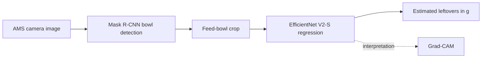

# Estimation of Concentrate Leftovers in Automated Milking Systems Using Computer Vision

**Research overview, detailed Materials and Methods, and a downloadable Windows application for estimating concentrate leftovers from automated milking system (AMS) camera images.**

## Background and research objective

Automated milking systems can record the amount of concentrate **dispensed** to each cow, but this does not necessarily equal the amount **consumed**, because some feed may remain in the feeding bowl. Direct measurement of leftover concentrate after each milking visit is labor-intensive. A camera-based estimate of leftover weight could help characterize actual concentrate consumption and support more precise feeding management.

**This study aimed to develop and evaluate a two-dimensional computer-vision approach for estimating the mass of concentrate leftovers (g) in an AMS feeding bowl.**

## Overview of the approach

The study combined three complementary methods:

1. **Object detection:** A one-class Mask R-CNN model implemented in Detectron2 identified the feed bowl in images or video frames and supplied a rectangular bowl crop.
2. **Leftover-weight estimation:** An EfficientNet V2-S regression model estimated the mass of concentrate remaining in each selected bowl crop.
3. **Model interpretation:** Gradient-weighted Class Activation Mapping (Grad-CAM) was used to visualize image regions associated with the regression output.

The documented controlled-weight development dataset consisted of **315 images** of known leftover masses between **0 and 1,000 g** (252 training images and 63 internal-validation images). A separate set of naturally occurring leftovers contained 92 initial observations; **90 observations** remained in the restricted independent-test analysis after two high-weight exclusions; full-test performance with all 92 is also reported. Further details on sampling, model development, evaluation, and interpretation are given in the pages linked below.

## Materials and Methods

These pages provide the full reported research-method details, including camera and animal context, detector fitting, data collection, clip-to-crop selection, regression training, evaluation, and Grad-CAM visualization. They complement the shorter JDS Communications manuscript. Details that cannot be verified from the manuscript or prior research documentation are explicitly identified rather than reconstructed.

| Section | Description |
| --- | --- |
| [01 — Object detection](Materials_and_Methods/01_object_detection.md) | Camera input, Mask R-CNN, detection criteria, and extraction of the feed-bowl crop |
| [02 — Leftover-weight estimation](Materials_and_Methods/02_leftover_weight_estimation.md) | Reference data, EfficientNet V2-S training, image preprocessing, prediction, and model evaluation |
| [03 — Grad-CAM interpretation](Materials_and_Methods/03_gradcam_interpretation.md) | Regression Grad-CAM workflow and interpretation of activation maps |

## Windows GUI application

A Windows application is available for applying the **trained detection and weight-estimation models** to cropped images, full images, or short video clips. The distributed application is intended for inference, not model training.

**[Download the latest Windows GUI (GitHub Releases)](../../releases/latest)**  
**[Read the GUI installation and user guide](gui/README.md)**

The downloadable release contains the executable, required runtime files, trained model checkpoints, and a selection of example inputs. Its `data/` folder does **not** contain the complete study dataset. The release asset to download is `AMS-Leftover-Estimator-app.zip`, not GitHub's automatically generated source-code archive.

## Availability and citation

This repository contains **written research methods and GUI usage documentation**. Python source code, training scripts, exact data-split and timestamp manifests, and Jupyter notebooks are not provided here. Consequently, the methods explain how the reported research was carried out but the repository alone cannot reproduce model training or all published statistics. The compiled application and trained checkpoints are distributed through [GitHub Releases](../../releases/latest); complete research data and original camera recordings are not included.

**Manuscript in preparation:** Thomas et al. *Estimation of automated milking system concentrate leftovers with 2-dimensional images and machine learning.* Please cite the published version once available. For analyses performed using the GUI, report the software release version and settings used.
