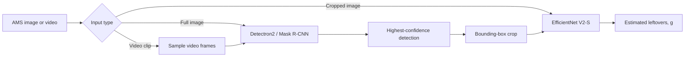

# Estimation of Concentrate Leftovers in Automated Milking Systems Using Computer Vision

**Research methods and a downloadable Windows application for estimating concentrate leftovers in automated milking system (AMS) feed bowls from images and short video clips.**

## Download the Windows GUI application

**[Download the latest AMS Leftover Estimator (Windows)](../../releases/latest)**


Open the release and download **`AMS-Leftover-Estimator-app.zip`** under **Assets**. Do not select GitHub's automatically generated *Source code (zip)* archive, which does not contain the executable.

### Contents of the application ZIP

```text
AMS-Leftover-Estimator-app/
├── AMS-Leftover-Estimator.exe
├── _internal/                 Required runtime libraries
├── Model/
│   ├── Detectron2.pth         Trained bowl detector
│   └── EfficientNet.pth       Trained leftover-weight estimator
└── data/                      Selected examples only
    ├── Clips/
    └── Cropped images/
```

**Both `.pth` model files are included in the release ZIP.** The `data/` directory contains only **a subset of example files**, not the full dataset used in the study.

### Quick start

1. Download `AMS-Leftover-Estimator-app.zip` from [Releases](../../releases/latest) and **extract the ZIP completely**.
2. Keep `AMS-Leftover-Estimator.exe`, `_internal/`, and `Model/` in the same extracted application directory.
3. Double-click **`AMS-Leftover-Estimator.exe`**. Installing Python is **not** required.
4. Use **Crop or Clip** (default) for an already-cropped feed-bowl image or a short video, or select **Full image** for an uncropped still image.
5. Choose a file. **Prediction starts automatically**. The result is displayed as estimated leftover weight in grams.

The app automatically locates the model files. Click the compact **Model input** indicator to view the model paths and advanced settings. For screenshots, file types, saved outputs, and troubleshooting, see the **[Windows GUI user guide](gui/README.md)**.

## Study overview

AMS management software typically records the quantity of concentrate dispensed, but this may differ from the quantity consumed if feed remains in the bowl. This study investigates a two-stage image-analysis approach for estimating **remaining concentrate weight (g)**:

1. **Object detection:** A one-class **Mask R-CNN**, implemented using **Detectron2**, detects the feed bowl in an image or a sampled video frame.
2. **Leftover-weight estimation:** An **EfficientNet V2-S** regression model predicts the weight of feed remaining from the detected **bounding-box crop**.

For a previously cropped image, the detector is bypassed and EfficientNet is applied directly. For a video clip, the GUI selects **one highest-confidence crop** from the sampled frames and applies EfficientNet **once**; it does not average predictions across frames.



**Detection confidence describes confidence in finding the feed bowl, not uncertainty in the predicted mass.**

## Materials and Methods

The methods are documented in separate pages:

1. **[Study design, imaging, and datasets](Materials_and_Methods/00_study_design_and_data.md)** — sample acquisition, reference weights, clip preparation, and partitioning.
2. **[Object detection and image extraction](Materials_and_Methods/01_object_detection.md)** — Mask R-CNN configuration, frame selection, confidence thresholds, and cropping.
3. **[Leftover-weight estimation](Materials_and_Methods/02_leftover_weight_estimation.md)** — EfficientNet V2-S, image preprocessing, training strategy, and transformation back to grams.
4. **[Model evaluation](Materials_and_Methods/03_model_evaluation.md)** — error metrics, independent evaluation, and sensitivity analyses.
5. **[Grad-CAM interpretation](Materials_and_Methods/04_gradcam_interpretation.md)** — qualitative interpretation of regression predictions.

### Dataset summary

| Dataset | Observations or images | Purpose |
| --- | ---: | --- |
| Controlled-weight development images | **315** | Reference masses of 0–1,000 g, with 15 images per 50-g level |
| Training images | **252** | Develop EfficientNet regression model |
| Internal validation images | **63** | Select checkpoint and monitor training |
| Naturally occurring observations initially available | **92** | Separate field observations |
| Excluded naturally occurring observations | **2** | Excluded before final independent evaluation |
| **Final independent evaluation** | **90** | Evaluate naturally occurring leftovers |

The final exclusion criteria and performance statistics should be reported from the finalized analysis. The independent evaluation observations are not equivalent to external validation at unfamiliar farms.

## Repository contents

```text
README.md
Materials_and_Methods/
  00_study_design_and_data.md
  01_object_detection.md
  02_leftover_weight_estimation.md
  03_model_evaluation.md
  04_gradcam_interpretation.md
gui/
  README.md                   Windows GUI user guide
```

The GitHub repository is **documentation-focused**. The compiled GUI (`.exe` and `_internal/`), trained checkpoints (`.pth`), and selected example media are **release assets**, not ordinary files in the Git repository. **Neither the inference source code nor the training and evaluation notebooks are published here.**

## Data availability and reproducibility

The release package contains **only selected example clips and cropped images**. The full camera recordings, complete development/validation/evaluation data, and associated animal- or session-level records are **not distributed** in this repository or its release ZIP. Similarly, training code and notebooks are not provided. The written methods and downloadable GUI therefore support understanding and applying the trained models but do not constitute a complete, independently reproducible model-training package.

The two trained checkpoints are included in the Windows release for inference. Their use, any third-party data, and redistribution remain subject to applicable permissions. No public software or data license is implied unless the repository explicitly supplies one.

## Citation

**Manuscript in preparation:** *Estimation of automated milking system concentrate leftovers with 2-dimensional images and machine learning* (Thomas et al.). Confirm the definitive title, author order, journal, year, and DOI before using a formal bibliographic citation. When reporting results obtained with the GUI, specify the release version and any nondefault inference settings.
