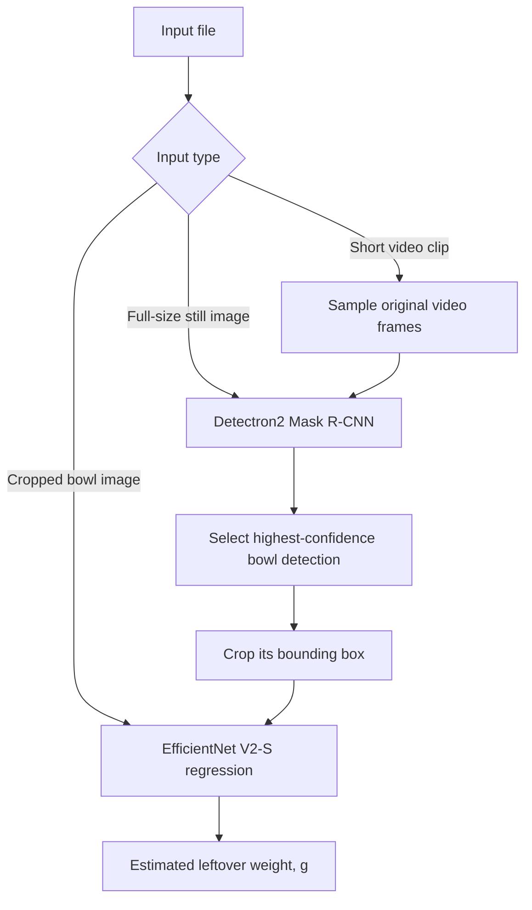

# Estimation of Concentrate Leftovers in Automated Milking Systems Using Computer Vision

**Research methods and a Windows GUI for estimating concentrate remaining in an automated milking system (AMS) feed bowl from images or short video clips.**

> **Project status:** Documentation associated with *Estimation of automated milking system concentrate leftovers with 2-dimensional images and machine learning* (Thomas et al.; manuscript in preparation). The research values described below are taken from the existing project documentation and should be checked against the final manuscript, source notebook, and data manifest. This repository is not a complete, independently executable reproduction of model training.

## Download Windows GUI Application

**[Download the latest version of AMS Leftover Estimator]([https://github.com/masayamatamura0-max/AMS-Concentrate-Leftover-Estimation/releases/latest](https://github.com/masayamatamura0-max/AMS-Concentrate-Leftover-Estimation-/releases/latest)**

The Windows GUI enables users to estimate concentrate leftovers directly from images or short video clips without installing Python or configuring a deep-learning environment.

### Installation and usage

1. Download `AMS-Leftover-Estimator-app.zip` from **Releases → Assets**.
2. Extract the ZIP file.
3. Run `AMS-Leftover-Estimator.exe`, keeping the `_internal` folder alongside it.
4. Place the trained model weights in a `Model` folder:
   - `Model/Detectron2.pth`
   - `Model/EfficientNet.pth`
5. Open a cropped image, full image, or video clip. Prediction starts automatically after file selection.

## Overview

AMS software can record the amount of concentrate **dispensed** to an individual cow, but dispensed feed is not necessarily consumed feed. Feed remaining in the AMS bowl can therefore affect estimates of concentrate intake. This project evaluates a camera-based approach to estimate the **mass of concentrate leftovers (g)**.

The approach combines two computer-vision tasks:

1. **Object detection:** a one-class **Mask R-CNN** detector implemented with **Detectron2** locates the feed bowl in a full image or sampled video frame.
2. **Leftover-weight estimation:** **EfficientNet V2-S**, adapted for image regression, predicts the mass of concentrate remaining from the detected **bounding-box crop**.

If the feed-bowl image has already been cropped, the application skips Detectron2 and runs only EfficientNet. For video input, it selects **one best crop** based on detector confidence and then performs **one** weight prediction.



**Important:** The detector's confidence score indicates how confidently it recognizes the bowl. It does **not** measure uncertainty in the predicted grams.

## Windows GUI: getting started

The GUI is intended for inference with trained checkpoints. It does **not** train Mask R-CNN or EfficientNet. The source is stored in the [`gui/`](gui/) folder; trained weights and generated EXEs are not included in this documentation.

### Step 1 — Obtain the application

Download a Windows release or a GitHub Actions artifact when one is available. For a build created with PyInstaller **`onedir`**, extract the full distribution and keep the executable alongside its supporting `_internal/` directory. `onedir` is recommended for faster startup compared with a single-file bundle.

If you maintain the GitHub Actions build workflow, you can build the EXE through **Actions → Build Stage 4 Windows → Run workflow** and select `bundle_mode = onedir`. The exact workflow name and artifact availability depend on the files present in your repository.

### Step 2 — Place the trained models

The application looks for these **exact names**:

```text
AMS-Leftover-Estimator/
├── AMS-Leftover-Estimator.exe
├── _internal/                # Required for a PyInstaller onedir build
└── Model/
    ├── Detectron2.pth        # Bowl detector
    └── EfficientNet.pth      # Leftover-weight regressor
```

The application searches `Model/` beside the input file, one directory above the input file, and beside the EXE (in that priority order). The **Model input** indicator shows whether a checkpoint was found. Click it to see file paths and advanced settings. *Found* and *Loaded* are different states: the weights are loaded into memory when prediction begins.

A checkpoint may require a matching **Detectron2 YAML configuration**, selectable under advanced settings. Checkpoints must be authorized for use and compatible with the implemented architecture.

### Step 3 — Choose your input

The interface presents **two modes**:

| GUI mode | File selected | What happens | Prediction preview |
| --- | --- | --- | --- |
| **Crop or Clip** (default) | Already-cropped bowl image | EfficientNet predicts directly | One large crop image |
| **Crop or Clip** (default) | Video clip | Sample video → Detectron2 → best crop → EfficientNet | Best original frame, detection overlay, crop |
| **Full image** | Uncropped still image | Detectron2 → bowl crop → EfficientNet | Original image, detection overlay, crop |

Use **Open image / clip…** (or **Open full image…**). The Windows file chooser initially opens at the **EXE's folder**. Selecting a supported file **automatically starts prediction**; you do not need to press the run button for the initial analysis.

**Supported inputs in the current GUI code:**

- Images: `.png`, `.jpg`, `.jpeg`, `.bmp`, `.tif`, `.tiff`, `.webp`
- Videos (Crop or Clip mode): `.mp4`, `.avi`, `.mov`, `.mkv`, `.m4v`

Video decoding depends on the codecs supported by the local OpenCV installation.

### Step 4 — Read and save the result

The **Prediction** area displays estimated leftover weight in **grams**. Cropped-image input shows a single enlarged image; clip and full-image inputs show the original/best frame, detection overlay, and selected crop.

- **Detect / Predict:** rerun the selected file (for example, after changing a sampling or confidence setting). This button uses the standard Windows control size and appearance.
- **Save crop & overlay…:** save `feed_bowl_crop.png` and, when detection was used, `detection_overlay.png`.
- **Model input → Advanced settings:** manually select `.pth` checkpoints, choose a detector YAML, or adjust the minimum detection confidence (default **0.90**).
- **Video sample every (s):** default **1.00 s**; for a typical 4-second/20-fps clip, approximately four frames are inspected (0, 1, 2, and 3 seconds).

The current GUI processes sampled frames in their **original orientation only** (no 180° rotation). It selects the highest-confidence crop and predicts its leftover weight **once**; it does not average predictions over every sampled frame. Sampling at 1.00 s reduces detection work but might miss a better crop available between sampled frames.

For screenshots, complete controls, troubleshooting, and source-code launch instructions, see the **[GUI user guide](gui/README.md)**.

## Research methods at a glance

### Data collection and partitioning

The project documentation describes a camera mounted over the AMS feed bowl, recording approximately **2,560 × 1,920 pixels** at **20 frames/s**. Short clips were associated with known-weight samples and naturally occurring leftovers.

| Dataset | Reported amount | Purpose |
| --- | ---: | --- |
| Controlled-weight development images | **315** | 0–1,000 g in 50-g increments; 15 images per level |
| Training split | **252** | Fit EfficientNet parameters |
| Internal validation split | **63** | Choose checkpoint and stop training |
| Separate naturally occurring observations | **92** | Independent evaluation |

The development split described in the final October research notebook was **80:20, stratified by exact reference mass**. Verify these numbers and any repeated-observation grouping against the final data manifest before publication. The independent observations were separate observations, but **not an external-farm validation set**.

### Object detection and frame selection

A one-class Detectron2 Mask R-CNN, based on **Mask R-CNN R50-FPN**, identifies the bowl. The crop is created from the **detected bounding box**, not by masking away background pixels. The documented final acceptance threshold is **0.90 detector confidence**.

The archived research notebook includes **0.05-s and 0.20-s** frame-sampling configurations and optional **180°-rotated candidates**. The exact research-run combination requires confirmation from the executed call sites. **Do not describe the present GUI's 1.00-s/no-rotation default as the validated research setting.**

### Leftover-weight regression

The development documentation describes an ImageNet-pretrained **EfficientNet V2-S** with a single regression output. Crops were converted to RGB, resized to **224 × 224**, and normalized with ImageNet means and standard deviations. The response was **ln(1 + weight in grams)**, trained using mean squared error loss. Inference converts the output back to grams with `max(0, expm1(output))`.

The model was evaluated on the **gram scale**, using metrics such as RMSE, MAE, and R². These documents do **not** supply measured model-accuracy values that are not available in the underlying repository.

### Model interpretation

The research notebook also used **Grad-CAM** with EfficientNet to visualize regions associated with the prediction. Such maps are **qualitative** and should not be treated as proof of causal importance.

## Materials and Methods — detailed documents

1. **[Study design, image acquisition, and datasets](Materials_and_Methods/00_study_design_and_data.md)** — experimental samples, independent observations, timing, and data split.
2. **[Object detection and image extraction](Materials_and_Methods/01_object_detection.md)** — Mask R-CNN, sampling, detection confidence, and crop selection.
3. **[Estimation of concentrate leftovers](Materials_and_Methods/02_leftover_weight_estimation.md)** — EfficientNet architecture, preprocessing, training, and back-transformation.
4. **[Model evaluation and reporting](Materials_and_Methods/03_model_evaluation.md)** — independent evaluation, metrics, threshold sensitivity, and leakage risks.
5. **[Grad-CAM interpretation](Materials_and_Methods/04_gradcam_interpretation.md)** — model visualization and interpretive limitations.

## Repository organization

```text
README.md                       Overview, study summary, GUI quick start
Materials_and_Methods/
  00_study_design_and_data.md
  01_object_detection.md
  02_leftover_weight_estimation.md
  03_model_evaluation.md
  04_gradcam_interpretation.md
gui/
  README.md                     Detailed GUI manual
  app.py                        GUI source (added separately)
  detection.py                  Detectron2 inference (added separately)
  inference.py                  EfficientNet inference (added separately)
  model_paths.py                Automatic weight discovery (added separately)
  requirements.txt              App dependencies (added separately)
DATA_AVAILABILITY.md            Data/code availability and limitations
CITATION.md                     Provisional project citation
.gitignore                      Avoids committing weights, data, and builds
```

The source-code and Windows-build workflow folders can be added or maintained independently of these Markdown documents. No `.pth` files, raw videos, or Windows binaries are supplied here.

## Data availability, reproducibility, and citation

The repository documentation does **not** make raw recordings, animal-level records, model-training manifests, final trained checkpoints, or the original full training notebooks publicly available. See [Data availability and reproducibility](DATA_AVAILABILITY.md) for the precise scope. The research manuscript's final protocol should take precedence when it has been reconciled with executable notebooks and source records.

For attribution and the current manuscript-in-preparation reference, see [Citation](CITATION.md). Confirm the final author list and bibliographic details before using a formal published citation.

**Software use note:** No license is granted merely by making source code visible on GitHub. The project team should agree on a software license and any model-weight/data-sharing permissions before public release.
